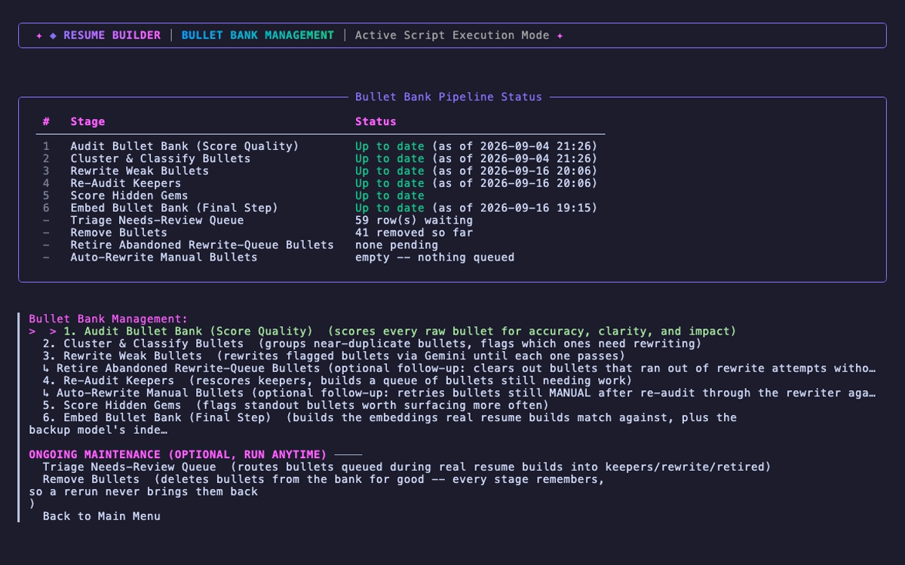
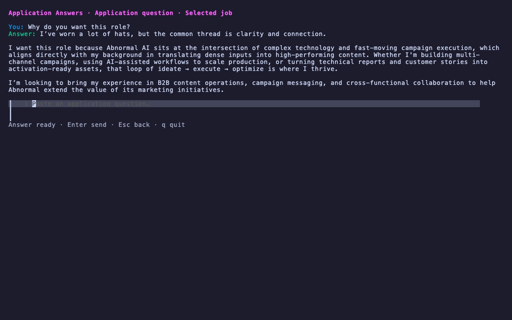

# 💎 RESUME-BUILDER
### The job-search pipeline that actually reads the room. ✨

[](https://github.com/moreganooooo/resume-builder/actions/workflows/pylint.yml?query=branch%3Amain)
[](https://www.python.org/)
[](https://golang.org/)
[](LICENSE.md)

Not a "type in your job title, get a generic ChatGPT resume" toy. This is an ultra-premium, full-stack career operations pipeline built because I was tired of every AI resume tool doing exactly one of those steps badly and calling it a product.

This system **scans** job postings, **checks** whether they’re still active, **scores** fit and ATS match, **tailors** resumes and cover letters using your verified experience and writing preferences, **exports** PDF and DOCX files, and **tracks** your applications.

Designed to be gorgeous, sparkling, and modular, it runs as a high-fidelity Terminal User Interface (TUI) on both your **Desktop computer** and **Android Linux Mobile (Google Pixel 10)**.

## What happens when a job asks for experience you don’t have?

Suppose a lifecycle marketing job asks you to **own contract renewals**, and your verified experience is **running email retention campaigns**.

| Step | Example |
| --- | --- |
| Draft claim | “Owned contract renewals.” |
| What the checker flags | “Renewals” matches a claim marked unsupported in this applicant’s profile. The ledger points to retention campaigns as the supported alternative. |
| Evidence-backed wording | “Ran email retention campaigns.” The renewal ownership requirement remains a gap. |

The claims ledger gives the drafter this rule, the resume validator flags matches, and the review step drops suggestions that would reintroduce the unsupported claim. The checks use rules from the applicant’s profile and work alongside the applicant’s own review.

[See how the ledger checks and filters this example](tests/test_claims_ledger.py#L47-L78).



*The Bullet Bank keeps source accomplishments in one place and lets applicants review flagged bullets before reusing them in tailored resumes.*

## Application answer chat

From Browse & Manage Jobs or Pipeline, select a role and press `a` to open
Application Answers. The chat drafts grounded answers using the job, evaluation,
company research, verified experience, and writing voice, then saves the
conversation back to that job. Sensitive EEO questions are never answered by
the model. Use `resume dashboard --view answers --job <path-or-id>` to open the
screen directly, or choose **Build Documents → One Role → Application Answers**
from the menu.

The command-line protocol is also available:

```bash
printf '%s' '{"job":"<path-or-id>","question":"Why do you want this role?"}' \
  | .venv/bin/python scripts/application_answers.py turn
```

<details>
<summary>See the main menu and application answer chat</summary>


*Main menu — Start a search, tailor documents, or check your application pipeline.*



*Application Answers — Draft a response for the selected role and review it in the terminal.*

</details>

---

```
   scan            liveness          evaluate           tailor / render          track
┌─────────┐     ┌───────────┐     ┌───────────┐     ┌──────────────────┐     ┌──────────┐
│ JobRight│ ──▶ │  is this  │ ──▶ │ score fit │ ──▶ │  write it in     │ ──▶ │  log the │
│ LinkedIn│     │ posting   │     │ & ATS     │     │  YOUR voice from │     │  build,  │
│ Wellfnd │     │ still     │     │ odds      │     │  a verified bank,│     │  link the│
│ Otta/YC │     │ live?     │     │           │     │  render clean PDF│     │  posting │
└─────────┘     └───────────┘     └───────────┘     └──────────────────┘     └──────────┘
```

---

## 🏛️ The 7 Core Architectural Pillars

### 1. 🌐 Multi-Board Ingestion & Anti-Bot Infrastructure
* **Comprehensive Provider Ecosystem & Batch Scanner:** Native ingestion for Greenhouse, Lever, Workable, SmartRecruiters, Recruitee, Workday, LinkedIn, JobRight, Wellfound, Otta, Y Combinator (Work at a Startup), Levels.fyi, and curated remote indexes with high-performance concurrent single-process batch execution (`board-scanners/run_provider.mjs --batch`).
* **Role Discovery & O*NET SOC Taxonomy:** Built-in title normalization and query alias expansion (`data/modern_title_aliases.yml` and `scripts/role_discovery.py`) mapping modern roles to formal O*NET Standard Occupational Classification codes.
* **Commercial Anti-Bot Fallbacks:** Automatic Scrape.do proxy gateway routing on Cloudflare / 403 blocks with per-site token-bucket rate limiting and millisecond randomized jitter.
* **Deduplication Hashing & Blacklists:** SHA-256 canonical posting deduplication and crowdsourced employer blacklists.
* **Local & Commute-Aware Search:** Offline geocoding (bundled GeoNames centroids, no API key, no network) scores every posting's real distance from your configured origin, with a 5–25 mile radius and a remote / hybrid / on-site filter you can combine. Handles the location strings postings actually use — exclusion fencing ("US Remote, excluding CA"), multi-hub roles scored by their *nearest* office, metro shorthand, and international rejection.
* **Full-Text Sources vs. Discovery Sources:** Indeed (via JobSpy) and USAJOBS return complete descriptions; aggregators like Jooble and Adzuna serve truncated teasers by design and are flagged as such rather than silently tailored against. `resume discover-employers` mines the employers those aggregators surface near you and tracks the ones with real ATS boards, so their full postings get scraped directly.
* **Staffing-Agency Boards:** Watch a local agency's public job board (no login) by listing it under `staffing_boards:` in your profile's `board_scanner/scan_filters.yml` — `type: jsonld` for boards whose posting pages carry schema.org `JobPosting` data (most WordPress/job-plugin sites), `type: hmg` for Haley Marketing boards, and an optional `link_pattern` regex when posting URLs don't contain `/job`. Postings pass the same title and location gates as Indeed and are labeled with the agency's name.
* **AI-Training Gig Detection:** Contract work producing training data for AI labs ("AI Trainer", "evaluate model responses", "$60/hour — Domain Expert") is labeled automatically, with the evidence shown. In the dashboard, `[i]` on Jobs or Pipeline cycles all → hide AI training → AI training only → staffing boards only. Nothing is hidden or rescored unless you ask.

### 2. 📊 Split-Agent Dual-Metric Intelligence
* **Capability Fit vs. Recruiter Friction:** Isolates functional engineering depth from bureaucratic recruiter friction to eliminate LLM cognitive saturation.
* **Piecewise Empirical Odds Engine:** Standardized conversion curves ($>4.5 \rightarrow 35\%$ callback rate) based on empirical tech hiring data.
* **Pre-Flight Capability Gating & Ghost Job Scorer:** Instant zero-cost heuristic screening and mathematical ghost job risk scoring ($0.0–1.0$).
* **Batch Skill-Gap Radar Matrix:** Aggregates missing skills across all pending postings to pinpoint the highest-leverage technologies to learn.

### 3. 🛡️ Audited Compounding Truth Engine
* **Evidence checks:** Tailoring draws from an audited bullet bank. The [claims ledger](scripts/claims_ledger.py) flags configured unsupported claims, and the [resume validator](scripts/validate_resume.py) checks whether metrics appear in the source bullets for the employer named in the draft.
* **STAR / Google XYZ Syntactic Quality Grader:** Enforces active past-tense verbs, quantifiable results, and causal connectors.
* **RFC 6902 JSON Patch Surgical Bullet Repair:** Precise JSON Patch engine (`scripts/patch_engine.py`) fixing failing bullets without regenerating entire documents.
* **Anti-Cliché Linter:** Eliminates banned AI idioms (*delve into, seamlessly, testament to, spearhead*) and preserves human authenticity.

### 4. 🗣️ Authenticity, Voice Cloning & ATS Science
* **Statistical Cadence & Voice Anchoring:** Enforces natural sentence length variance ($\sigma \ge 4.5$), burstiness spans ($\ge 12$), and type-token lexical diversity ($TTR \ge 0.46$).
* **Seniority & Company Scale Calibration:** Dynamically tunes word budgets and executive tone based on detected role scope (Startup vs Enterprise, IC vs Staff/VP).
* **Golden Ratio Cover Letters:** Strict 250–350 word budgets, 4-paragraph frameworks (*Hook -> Value Prop -> Proof/Culture -> CTA*), and front-loaded ATS keywords.

### 5. 📄 Multi-Format Vector & Typesetting Pipeline
* **Sub-Second Native Typst Vector Engine:** Blazing fast vector PDF generation across Standard, Executive, Compact 1-Page, and Modern Tech templates.
* **Tagged PDF:** The Playwright/Chromium export converts HTML and CSS to PDF with document tags and an outline.
* **Single-column DOCX:** The Word export uses a single-column layout with standard section headings.
* **Plain ASCII & JSONResume Exporters:** Clean text-box formatters and standard JSON Resume schema exports.

### 6. 💾 Career Operations CRM & Telemetry
* **Embedded ACID SQLite Database (`data.db`):** High-performance indexed storage for jobs, contacts, stages, and metrics with strict test-write isolation.
* **Automated IMAP / Email Sync Daemon & Write-Back:** Scans incoming recruiter messages, classifies intent (interview, offer, rejection), and updates stage transitions in `data.db` (`application_log`) via `--apply`.
* **Silence Detector & Chase List:** Evaluates application aging tiers (0–7d, 8–21d, 22+d) and drafts polite, tailored follow-up emails via `--chase`.
* **Recruiter & Hiring Manager Lead Enrichment:** Generates search dorks and CRM contact entries for direct outreach.
* **Bullet-Tag-to-Outcome Correlation:** Mathematical tracking correlating specific bullet categories and tags with real interview offers.

### 7. ⚡ Terminal Craft & Offline Multi-LLM Sovereignty
* **Charm TUI Cockpit (Bubble Tea v2 & Lip Gloss v2):** Instantaneous startup, Catppuccin themes, Harmonica spring physics animations, responsive 80x24 reflow, and interactive Knowledge Base Explorer.
* **Accessibility & Customization:** First-class support for `RESUME_BUILDER_MOTION=reduced`, `RESUME_BUILDER_ICONS=unicode`, and `RESUME_BUILDER_THEME=dark|light`.
* **Local Offline Tier (Ollama / vLLM):** Zero-cloud, local offline generation targeting DeepSeek-R1 / Llama 3 with zero API key dependencies.
* **Multi-Key API Rotation & Context Caching:** Automatic key failover on HTTP 429 and explicit prompt prefix caching for 90% token cost savings.
* **Decentralized Mobile P2P Sync:** Lightweight Termux client on Android Linux synced peer-to-peer via Syncthing.

---

## 🗺️ Documentation Directory

* [**🚀 Unified Setup & Installation**](docs/program_docs/installation.md) — The 1-click installer for macOS, Linux, WSL, and Android Termux.
* [**⚙️ How It Works: Operations & Usage Guide**](docs/program_docs/operations.md) — Detailed specifications for each pipeline module, dual-metric scoring, compounding bullet banks, voice cloning, and TUI cockpit.
* [**🤝 Contributing Guidelines**](CONTRIBUTING.md) — Development setup, test execution, and code style.
* [**📜 Code of Conduct**](CODE_OF_CONDUCT.md) — Standards and community pledge.
* [**🔒 Security Policy**](SECURITY.md) — Vulnerability reporting and local data sovereignty disclosures.
* [**💬 FAQ & Troubleshooting**](docs/program_docs/faq.md) — Quick fixes for session cookies, Playwright, API keys, TUI customization, and synchronization.

---

## 🎯 Quick Start Commands

```bash
# Launch the main menu & TUI cockpit
resume

# Launch into a specific profile
resume --profile morgan

# Run self-healing health diagnostics across all checks
resume doctor

# Run a quick smoke-test against a sample job posting
resume sample

# Find local employers with public ATS boards and track them
resume discover-employers            # preview
resume discover-employers --apply    # write them

# Scan for new jobs on LinkedIn, Wellfound, or Otta
resume scan --source linkedin --query "Staff Software Engineer"

# View executive mission control cockpit in terminal
python scripts/mission_control.py

# Export data lake to Parquet, DuckDB, or Excel
python scripts/export_data.py
```

Let's go crush this job search! 🚀
