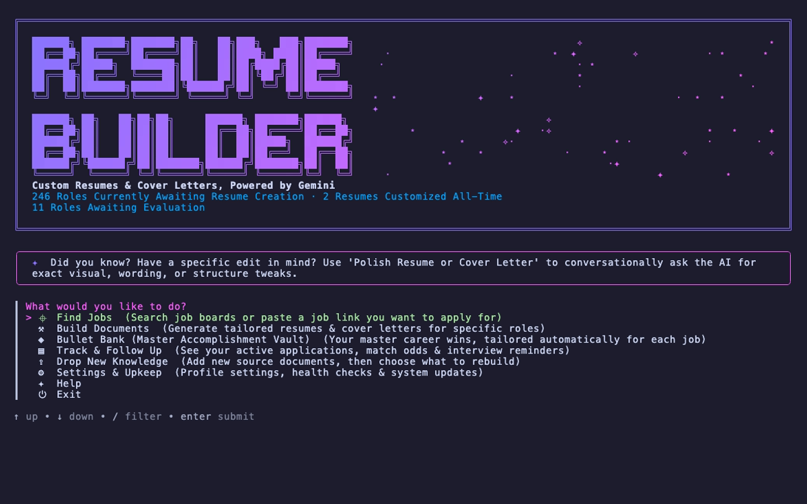

# Resume Builder

Resume Builder helps you find jobs, decide which ones are worth applying to, and tailor your applications using experience you can stand behind. It’s an open-source tool you run in your terminal.

I built it during my own job search. I once spent most of a day getting one AI-assisted resume right. Getting it right meant checking the facts, fixing the layout, and making sure the whole thing sounded like me. I wanted a way to save the work I’d already done and build on it for the next application.

## What you can do

1. **Find roles that fit your search.** Look across job boards or paste in a posting you’ve found. Filter by remote, hybrid, or on-site work and check whether a listing is still open.
2. **Decide where to spend your time.** See where your experience matches the posting, where there are gaps, and what might make an application harder to get through. Use the scores to compare roles and make your own call.
3. **Write the application.** Save accomplishments in a Bullet Bank, then use them to draft a resume and cover letter for a specific role. Use writing samples to guide the tone. Export a PDF or an editable Word document.
4. **Keep track of what happens next.** See which roles you’ve applied to, where you’re waiting for a reply, and when it might be time to follow up.

## What happens when a job asks for experience you don’t have?

Say a job asks you to **own contract renewals**. You’ve run **email retention campaigns**, which is relevant experience, and you’ve never owned renewals. It’s an easy distinction to lose when you’re tailoring a draft to a posting.

| If the draft says… | What Resume Builder does |
| --- | --- |
| “Owned contract renewals.” | Flags the claim when your profile marks renewals as unsupported. |
| “Ran email retention campaigns.” | Keeps the supported experience available to use. Renewal ownership remains a gap. |

You can record distinctions like this in your profile’s **claims ledger**. The drafting and review steps use those rules, and the review step can drop suggestions that would bring an unsupported claim back. You still make the final call on what goes into your resume. [See the checks behind this example](tests/test_claims_ledger.py#L47-L78).

*The Bullet Bank gives your accomplishments a home and shows which bullets are ready to reuse or still need a look.*

## Application answer chat

If a form asks “Why do you want this role?”, you can draft an answer from the job’s details and your own experience. Select a role in **Browse & Manage Jobs** or **Pipeline** and press `a` to open Application Answers. The draft stays with the job so you can come back to it.

See the main menu and application answer chat

*The main menu brings job search, document drafting, and application tracking together.*

*Draft an answer for the role you’re looking at and review it in the terminal.*

## Get started

1. Follow the [installation guide](docs/program_docs/installation.md) for macOS, Linux, Windows with WSL, or Android with Termux. The standard setup uses a Gemini API key for AI features.
2. Run `resume` in your terminal and choose **New User? Start Here!** to set up your profile.
3. Under **Find Jobs**, search for a role or add a posting you already have. Start with one job and see what you’d want to use in your application.

If you hit a setup snag, run `resume doctor` or check the [troubleshooting guide](docs/program_docs/faq.md).

## For contributors and curious readers

- [Usage guide](docs/program_docs/operations.md) for commands, scoring, and the document workflow.
- [Architecture notes](ARCHITECTURE.md) for how the code fits together.
- [Contributing guide](CONTRIBUTING.md), [code of conduct](CODE_OF_CONDUCT.md), and [security policy](SECURITY.md).

If you try it, I’d love to hear what helped and where you got stuck. A quick note in [GitHub Issues](https://github.com/moreganooooo/resume-builder/issues) is plenty.
